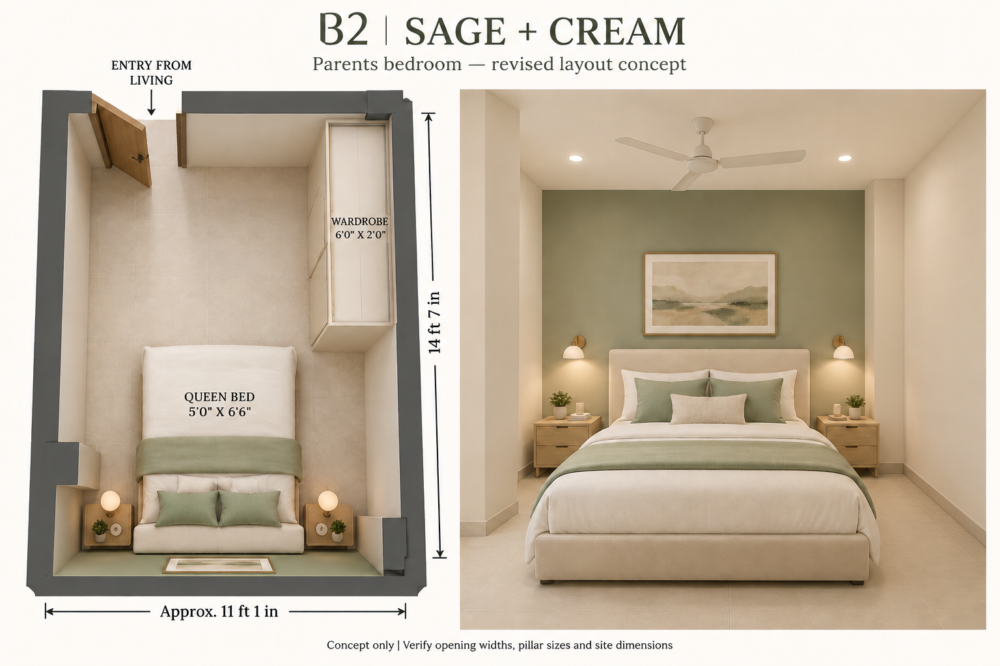

# Interior design concepts

B1 is the user’s bedroom. B2 is the parents’ bedroom.

## B2 — selected sage + cream concept, revised to the supplied plan

[Open the revised image at full size](concepts/B2-parents-bedroom/sage-cream-plan-based.png)

This is the current design direction for the parents’ bedroom, B2, at the bottom right of the flat plan. **B2 has no balcony.** The balcony belongs to B1.

### Plan interpretation and proposed furniture

- Follow the owner’s legend: single lines indicate doors, double lines indicate walls, and small rectangles indicate pillars.
- Interpret the short single-line section at the upper-left of B2 as its entrance from the living/dining room. Door swing shown is illustrative, not confirmed by the drawing.
- Use approximate room dimensions of 11′1″ × 14′7″; confirm the partly obscured first dimension on site.
- Position a queen mattress, nominally 5′ × 6′6″, with its headboard against the bottom wall. The finished bed frame will be larger.
- Place a proposed 6′ long × 2′ deep sliding wardrobe along the upper part of the right wall, toward the entrance and beyond the bed’s foot area.
- Retain the visible side-wall pillar projections conceptually; their exact sizes and offsets need measurement. Keep the entrance route and bedside access clear when sizing the furniture.
- Use pale sage, cream upholstery, light oak, matte light flooring and restrained reading lights. No balcony or unverified windows have been added. Existing ventilation/window provision still needs confirmation before a final design.

The overhead panel communicates the proposed arrangement; the perspective communicates finishes. These AI-generated views are not scaled construction drawings. Confirm opening widths, door swing, pillar dimensions, bed-frame dimensions and all furniture clearances before ordering or building.

---

## Earlier palette studies — superseded layouts

Three simple, bright, premium style directions:

1. **Ivory + oak:** warm ivory, pale oak and cream upholstery.
2. **Sage + cream:** soft green accents with warm white and light wood.
3. **Beige + brass:** warm neutrals, restrained wall mouldings and brass details.

[Open full-size image](concepts/B2-parents-bedroom/light-modern-concepts.png)

### Alternative concept board

These AI-generated images illustrate finishes and style, not a measured furniture layout. B2 is approximately 11′1″ × 14′7″ based on the supplied plan; the first dimension is partly obscured. Door and window positions, furniture clearances and site dimensions must be confirmed before finalising the design.
