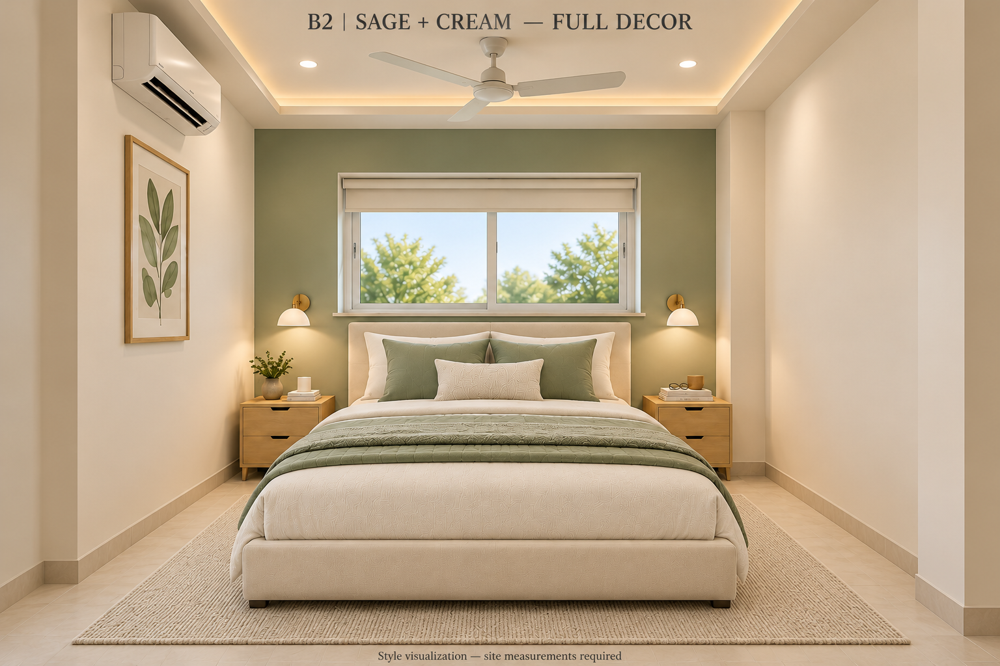
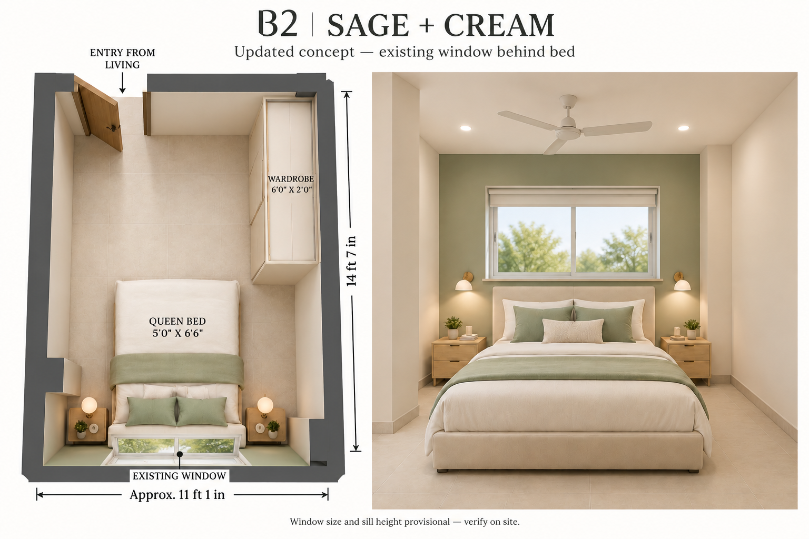
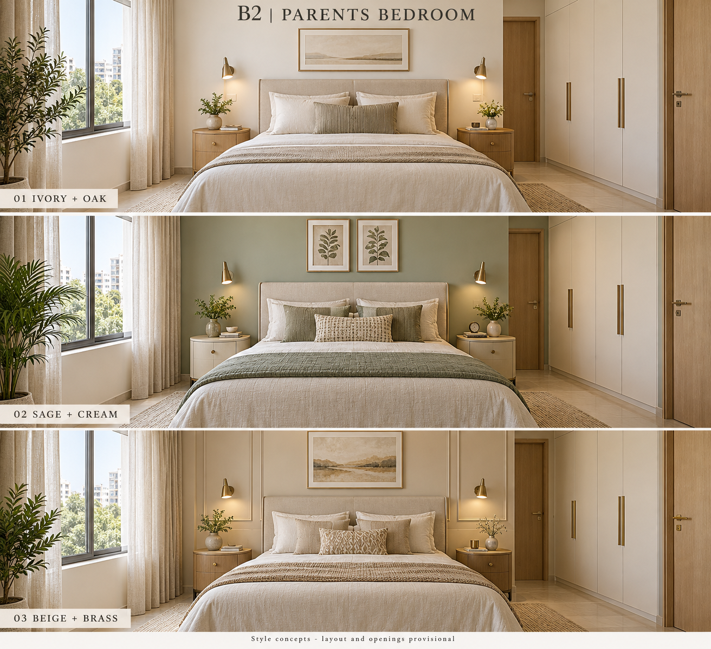
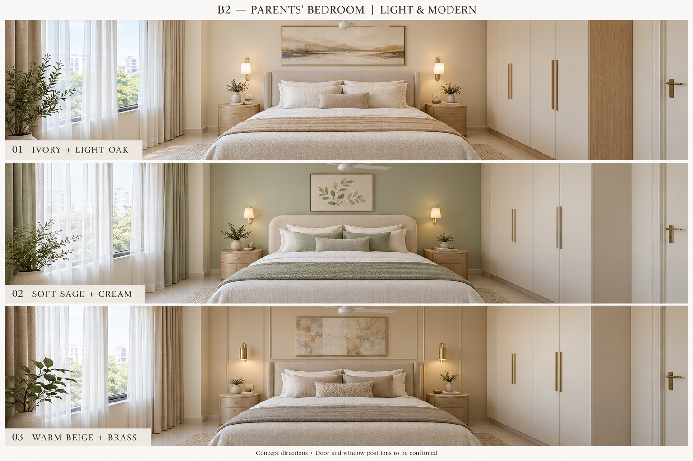

# Interior design concepts

B1 is the user’s bedroom. B2 is the parents’ bedroom.

## B2 — latest full décor concept

[Open the full décor image](concepts/B2-parents-bedroom/sage-cream-full-decor.png)

The selected sage-and-cream style now includes an oatmeal low-pile rug, layered bedding, light oak bedside storage, botanical art, small accessories, brass reading lights, a cream window blind, a white ceiling fan and a split AC. The existing window stays behind the bed; B2 has no balcony. The wardrobe remains toward the entrance, outside this camera view.

### Proposed sizes and installation notes

These are design targets, not measured or guaranteed dimensions in the generated image:

| Item | Proposed size / arrangement |
| --- | --- |
| Room | Approximately 11′1″ × 14′7″ from the plan; verify on site |
| Queen mattress | 5′ × 6′6″ |
| Bed frame | Approximately 5′4″ × 6′10″, subject to selected product |
| Bedside tables | 18″ wide × 16″ deep each |
| Rug | 9′ across room × 6′ along room, under lower portion of bed; confirm it clears wardrobe and bedside tables |
| Wardrobe | 6′ long × 2′ deep, upper right wall near entrance |
| Fan | Approximately 48″ sweep; confirm suitability and manufacturer clearances |

- A shallow perimeter false-ceiling border is optional, not required. The concept suggests about a 4″ drop with the central slab retained; detail it only after measuring ceiling height and checking the lighting system. Mount the fan to structural support and maintain manufacturer blade clearances. If height is insufficient, omit the border and use surface-mounted lighting.
- Use separately switched, dimmable warm-white ambient lighting and bedside reading lights; position downlights clear of the fan sweep to avoid flicker effects.
- AC placement on the left wall is conceptual. Confirm unit sizing, intake/service clearances, condensate drainage and outdoor-unit routing with the installer; direct airflow away from sleeping faces.
- Keep the headboard below the actual window sill. Verify window access, pillar projections and clear walking routes before ordering furniture. A target of 30–36″ clear circulation must be checked against the actual room and furniture, not inferred from the rendering.
- Use a flat rug with a nonslip underlay and avoid raised or curled edges.

This perspective illustrates décor and finishes, not a scaled construction drawing. Window dimensions, sill height, pillar sizes and ceiling height remain unverified.

---

## Previous layout concept — existing window confirmed

[Open the revised image at full size](concepts/B2-parents-bedroom/sage-cream-existing-window.png)

This is the current design direction for the parents’ bedroom, B2, at the bottom right of the flat plan. **B2 has no balcony.** The balcony belongs to B1.

### Plan interpretation and proposed furniture

- Follow the owner’s legend: single lines indicate doors, double lines indicate walls, and small rectangles indicate pillars.
- Interpret the short single-line section at the upper-left of B2 as its entrance from the living/dining room. Door swing shown is illustrative, not confirmed by the drawing.
- Use approximate room dimensions of 11′1″ × 14′7″; confirm the partly obscured first dimension on site.
- Position a queen mattress, nominally 5′ × 6′6″, with a low headboard on the bottom wall beneath the existing window. Keep the finished headboard below the actual sill and clear of the window operation. The finished bed frame will be larger than the mattress.
- Place a proposed 6′ long × 2′ deep sliding wardrobe along the upper part of the right wall, toward the entrance and beyond the bed’s foot area.
- Retain the visible side-wall pillar projections conceptually; their exact sizes and offsets need measurement. Keep the entrance route and bedside access clear when sizing the furniture.
- Use pale sage, cream upholstery, light oak, matte light flooring and restrained reading lights. The owner has confirmed a window in the bottom wall where the artwork appeared in the previous concept. Both views now show this window; the artwork has been removed. No balcony has been added. The depicted window width, height, sliding mechanism and sill height are provisional, not measured specifications.

Use a recess-mounted cream blind for privacy and light control. Confirm comfortable access to the window handles and blind controls; if the actual sill is too low for a headboard or reaching the window is awkward, revise the bed position after taking measurements.

[Previous concept before the window correction](concepts/B2-parents-bedroom/sage-cream-plan-based.png)

The overhead panel communicates the proposed arrangement; the perspective communicates finishes. These AI-generated views are not scaled construction drawings. Confirm window dimensions and sill height, opening widths, door swing, pillar dimensions, bed-frame dimensions and all furniture clearances before ordering or building.

---

## Earlier palette studies — superseded layouts

Three simple, bright, premium style directions:

1. **Ivory + oak:** warm ivory, pale oak and cream upholstery.
2. **Sage + cream:** soft green accents with warm white and light wood.
3. **Beige + brass:** warm neutrals, restrained wall mouldings and brass details.

[Open full-size image](concepts/B2-parents-bedroom/light-modern-concepts.png)

### Alternative concept board

These AI-generated images illustrate finishes and style, not a measured furniture layout. B2 is approximately 11′1″ × 14′7″ based on the supplied plan; the first dimension is partly obscured. Door and window positions, furniture clearances and site dimensions must be confirmed before finalising the design.
