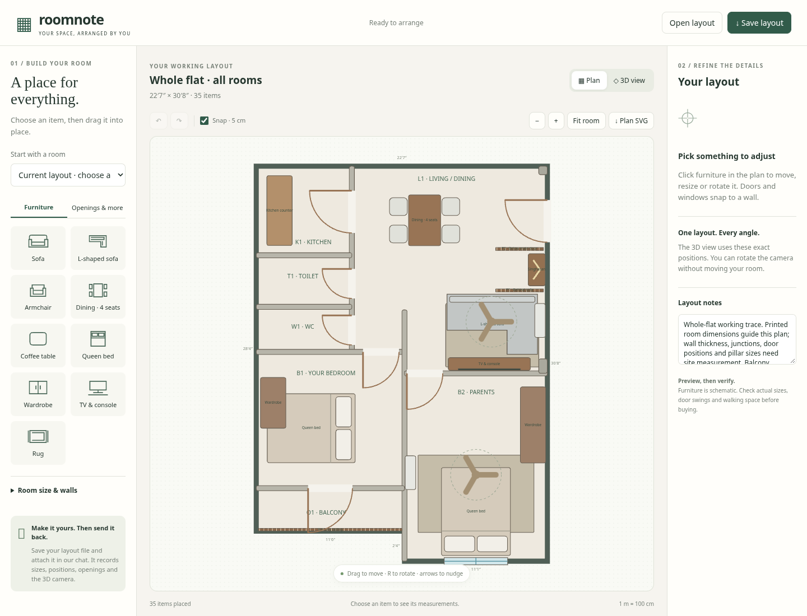
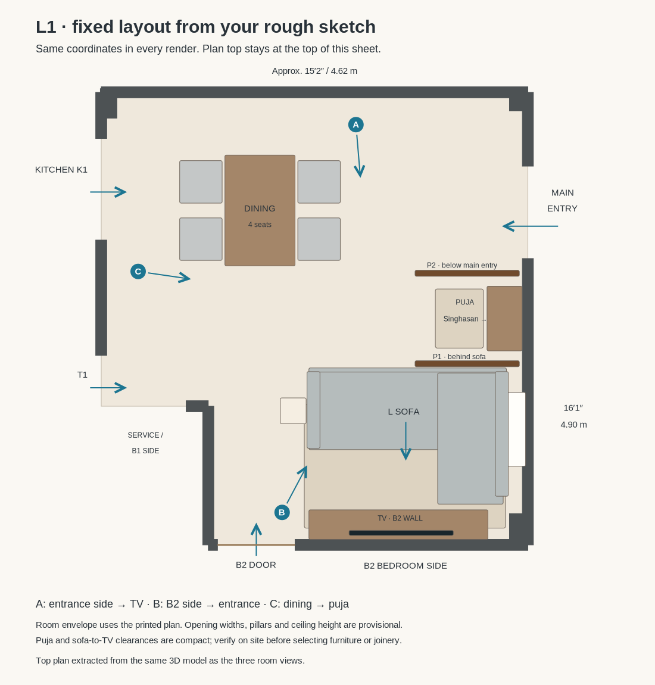
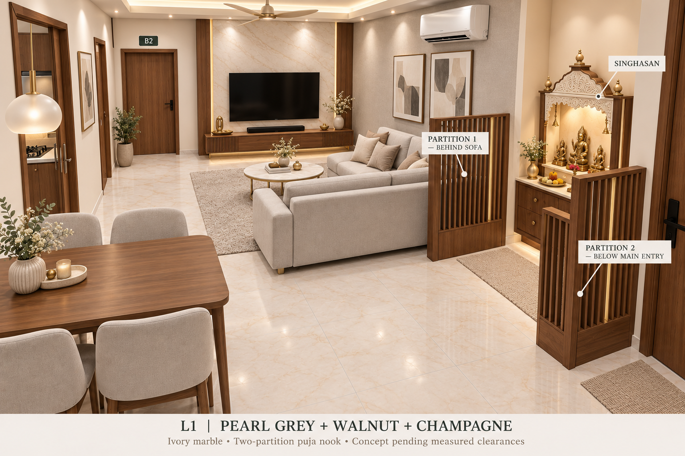
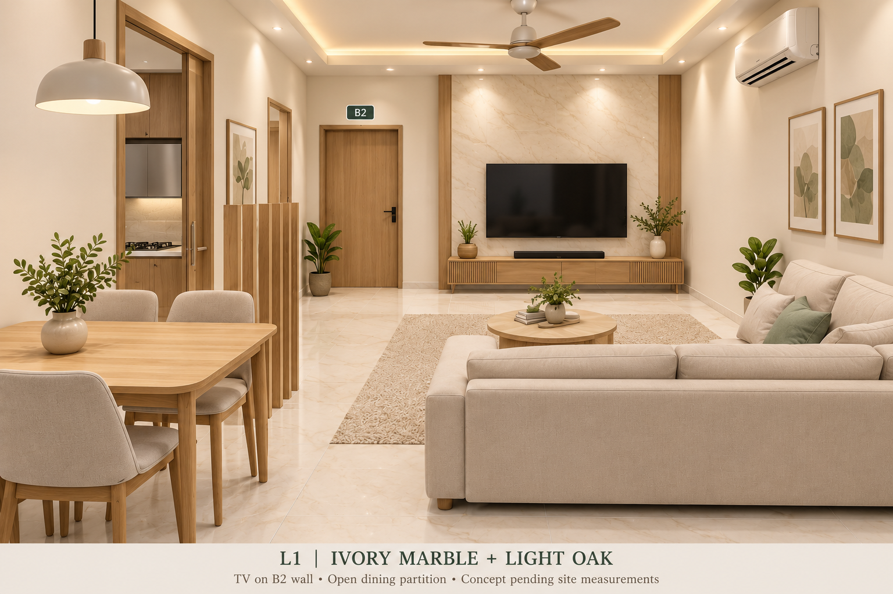
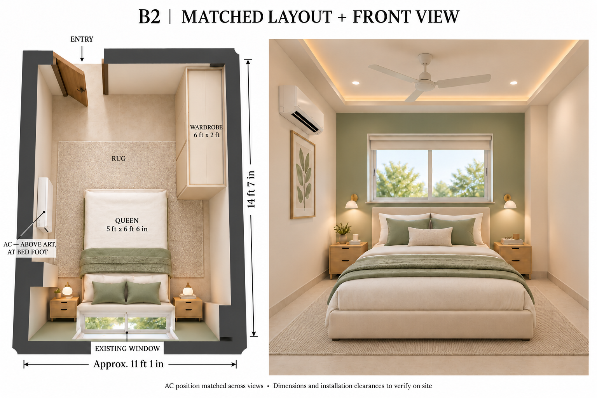

# Interior design concepts

B1 is the user’s bedroom. B2 is the parents’ bedroom.

## Download your whole-flat planner

**[Download Roomnote ZIP](https://github.com/tirthankardgen-cell/Interior-design-/raw/refs/heads/main/downloads/roomnote-planner.zip)** → extract → open **Roomnote.html** in your browser.

Arrange **the entire flat: living/dining, kitchen, toilet, WC, B1, B2 and balcony**. Drag furniture, add windows and doors, move internal walls, enter real measurements, and orbit a matching 3D preview. No account or internet connection is needed after downloading.

Click **Save layout** and attach the downloaded JSON in our chat to use your arrangement for subsequent realistic renders. The app provides a schematic 3D preview; it does not generate photorealistic images itself. Existing openings and structural details remain provisional until measured.

[Full instructions](planner/README.md) · [Download HTML directly](https://github.com/tirthankardgen-cell/Interior-design-/raw/refs/heads/main/planner.html)

---

## L1 — current layout: matched to the owner’s rough sketch

**[Open the consistent top and room views](concepts/L1-living-dining/fixed-layout/README.md)**

The hall has been rebuilt as one 3D scene using the owner’s rough top view. Dining runs lengthwise beside the upper-left kitchen access. The right-side puja bay has two partitions, followed by the L sofa facing the TV on B2’s wall. Main entry stays upper-right. Every room view uses the same geometry; only the camera changes.

| View | Direction |
| --- | --- |
| [A](concepts/L1-living-dining/fixed-layout/02-entry-to-tv.png) | Entrance side toward B2/TV |
| [B](concepts/L1-living-dining/fixed-layout/03-tv-to-entry.png) | B2 side back toward the entrance |
| [C](concepts/L1-living-dining/fixed-layout/04-dining-to-puja.png) | Dining side across to the puja bay |

These are layout-check renders with simplified finishes. Earlier polished hall images below are finish references only and are superseded for spatial arrangement. The printed room size sets the model envelope; door widths, pillars, notch and ceiling remain estimates. The compact puja bay and sofa-to-TV distance need site confirmation.

---

## L1 — earlier finish study: pearl grey, walnut and champagne

[Open the latest living and puja concept](concepts/L1-living-dining/walnut-pearl-puja-two-partitions.png)

The hall now has its own palette: pearl-grey upholstery, medium walnut furniture and partitions, restrained champagne-metal accents, and the requested ivory marble floor and TV panel. Abstract neutral artwork replaces the bedroom’s sage-and-oak styling.

### Updated arrangement

- Move the L sofa closer to the TV while keeping it facing the wall shared with B2. Keep B2’s doorway and the kitchen/bedroom access routes clear.
- Create a dedicated puja area with a Singhasan behind the sofa on the main-entry side.
- Use two short open partitions: one behind the sofa, and another below the main entrance on the right side in the original plan orientation. “Below the door” is interpreted as below the main entry.
- Keep an accessible opening between the screens. The walnut-and-ivory Singhasan has closed base storage, a small offering surface and separate gentle lighting.
- Retain four-seat dining near the upper-left kitchen access, the ceiling fan, layered lighting and conceptual AC placement. L1 has no windows.

The image is a furnishing concept rather than a measured plan. The depicted entry door leaf and screen relation are illustrative. Verify door swing, landing, pillar offsets, partition depth and puja standing/kneeling space before fixing this arrangement; neither screen may obstruct the entrance or circulation. Singhasan dimensions and deity arrangement should be adapted to the owner’s actual idols and worship practice. Measure the TV viewing distance from the selected sofa position and choose it for the actual TV size. The lighting and ceiling details remain subject to ceiling height and installation requirements.

---

## Earlier L1 theme — ivory marble and light oak

[Open the living and dining concept](concepts/L1-living-dining/ivory-marble-partition.png)

### Owner-confirmed requirements

- Combined living/dining L1, labelled 15′2″ × 16′1″ in the supplied plan.
- No windows in L1. Main entry at the top-right corner of the original plan.
- L-shaped sofa facing a TV on the wall shared with bedroom B2, with B2 access kept clear.
- Four-seat dining table near the kitchen, with an open partition separating dining from seating.
- Kitchen access follows the upper-left side of L1 beside K1 in the original plan, rather than the invented entrance in earlier renders.
- Ivory marble flooring; this concept also uses an ivory marble TV feature panel with light oak accents.

### Proposed concept

The view looks from the entry side toward B2’s shared wall; the main entry is behind the camera. The cream L sofa faces the TV, and a short open oak slat partition separates it from dining while keeping the kitchen route open. Finishes include ivory marble with subtle beige veining, cream upholstery, light oak, sage accents and an oatmeal rug. Closed TV storage, a dining pendant, ambient ceiling lighting, a fan and a split AC complete the furnishing study.

Furniture targets for a measured layout: a compact L sofa around 7′6″–8′ overall with a 5′–5′6″ chaise, a 4′ × 2′6″ four-seat table, a shallow 12″–14″ TV console and a compact rounded coffee table. Confirm actual furniture sizes, chair pullout, TV viewing distance and continuous clear routes on site. The partition length and position must suit the kitchen opening and sofa footprint; it should not cross an access route.

This image is a concept visualization, not a measured drawing. Door widths, exact openings, pillar sizes, ceiling height and circulation dimensions remain unverified. The kitchen opening follows the upper-left relationship in the supplied plan, but its pictured width, leaf and joinery are illustrative. Confirm the existing ventilation arrangement for the windowless hall before specifying AC and ceiling details. The ceiling border is optional, subject to height and service clearances. Use a low-sheen finish for the ivory marble and a nonslip underlay beneath the rug.

---

## B2 — corrected AC position in top and front views

[Open the corrected layout and front view](concepts/B2-parents-bedroom/sage-cream-matched-ac-layout.png)

The owner selected the second front view as the reference. The AC stays high on the left side wall, above the botanical artwork, near the bed’s foot. The overhead view has been corrected to show that position instead of placing the AC near the entrance. In the overhead cutaway, the artwork below the AC is hidden by the unit.

The sage-and-cream finishes, existing window behind the bed, rug, fan, bedside lighting and shallow ceiling border follow the selected front-view design. Room dimensions and all installation clearances remain provisional until site measurement; the illustration does not establish exact distances or a measured furniture layout. The rug proportions in the generated overhead are illustrative; use the proposed sizing notes below when developing a measured plan.

---

## Selected front-view décor reference

[Open the full décor image](concepts/B2-parents-bedroom/sage-cream-full-decor.png)

The selected sage-and-cream style now includes an oatmeal low-pile rug, layered bedding, light oak bedside storage, botanical art, small accessories, brass reading lights, a cream window blind, a white ceiling fan and a split AC. The existing window stays behind the bed; B2 has no balcony. The wardrobe remains toward the entrance, outside this camera view.

### Proposed sizes and installation notes

These are design targets, not measured or guaranteed dimensions in the generated image:

| Item | Proposed size / arrangement |
| --- | --- |
| Room | Approximately 11′1″ × 14′7″ from the plan; verify on site |
| Queen mattress | 5′ × 6′6″ |
| Bed frame | Approximately 5′4″ × 6′10″, subject to selected product |
| Bedside tables | 18″ wide × 16″ deep each |
| Rug | 9′ across room × 6′ along room, under lower portion of bed; confirm it clears wardrobe and bedside tables |
| Wardrobe | 6′ long × 2′ deep, upper right wall near entrance |
| Fan | Approximately 48″ sweep; confirm suitability and manufacturer clearances |

- A shallow perimeter false-ceiling border is optional, not required. The concept suggests about a 4″ drop with the central slab retained; detail it only after measuring ceiling height and checking the lighting system. Mount the fan to structural support and maintain manufacturer blade clearances. If height is insufficient, omit the border and use surface-mounted lighting.
- Use separately switched, dimmable warm-white ambient lighting and bedside reading lights; position downlights clear of the fan sweep to avoid flicker effects.
- The selected AC position is high on the left wall near the bed’s foot, above the botanical artwork, as shown in the corrected paired views. Its exact mounting position remains conceptual. Confirm unit sizing, intake/service clearances, condensate drainage and outdoor-unit routing with the installer; direct airflow away from sleeping faces.
- Keep the headboard below the actual window sill. Verify window access, pillar projections and clear walking routes before ordering furniture. A target of 30–36″ clear circulation must be checked against the actual room and furniture, not inferred from the rendering.
- Use a flat rug with a nonslip underlay and avoid raised or curled edges.

This perspective illustrates décor and finishes, not a scaled construction drawing. Window dimensions, sill height, pillar sizes and ceiling height remain unverified.

---

## Previous layout concept — existing window confirmed

[Open the revised image at full size](concepts/B2-parents-bedroom/sage-cream-existing-window.png)

This is the current design direction for the parents’ bedroom, B2, at the bottom right of the flat plan. **B2 has no balcony.** The balcony belongs to B1.

### Plan interpretation and proposed furniture

- Follow the owner’s legend: single lines indicate doors, double lines indicate walls, and small rectangles indicate pillars.
- Interpret the short single-line section at the upper-left of B2 as its entrance from the living/dining room. Door swing shown is illustrative, not confirmed by the drawing.
- Use approximate room dimensions of 11′1″ × 14′7″; confirm the partly obscured first dimension on site.
- Position a queen mattress, nominally 5′ × 6′6″, with a low headboard on the bottom wall beneath the existing window. Keep the finished headboard below the actual sill and clear of the window operation. The finished bed frame will be larger than the mattress.
- Place a proposed 6′ long × 2′ deep sliding wardrobe along the upper part of the right wall, toward the entrance and beyond the bed’s foot area.
- Retain the visible side-wall pillar projections conceptually; their exact sizes and offsets need measurement. Keep the entrance route and bedside access clear when sizing the furniture.
- Use pale sage, cream upholstery, light oak, matte light flooring and restrained reading lights. The owner has confirmed a window in the bottom wall where the artwork appeared in the previous concept. Both views now show this window; the artwork has been removed. No balcony has been added. The depicted window width, height, sliding mechanism and sill height are provisional, not measured specifications.

Use a recess-mounted cream blind for privacy and light control. Confirm comfortable access to the window handles and blind controls; if the actual sill is too low for a headboard or reaching the window is awkward, revise the bed position after taking measurements.

[Previous concept before the window correction](concepts/B2-parents-bedroom/sage-cream-plan-based.png)

The overhead panel communicates the proposed arrangement; the perspective communicates finishes. These AI-generated views are not scaled construction drawings. Confirm window dimensions and sill height, opening widths, door swing, pillar dimensions, bed-frame dimensions and all furniture clearances before ordering or building.

---

## Earlier palette studies — superseded layouts

Three simple, bright, premium style directions:

1. **Ivory + oak:** warm ivory, pale oak and cream upholstery.
2. **Sage + cream:** soft green accents with warm white and light wood.
3. **Beige + brass:** warm neutrals, restrained wall mouldings and brass details.

[Open full-size image](concepts/B2-parents-bedroom/light-modern-concepts.png)

### Alternative concept board

These AI-generated images illustrate finishes and style, not a measured furniture layout. B2 is approximately 11′1″ × 14′7″ based on the supplied plan; the first dimension is partly obscured. Door and window positions, furniture clearances and site dimensions must be confirmed before finalising the design.
