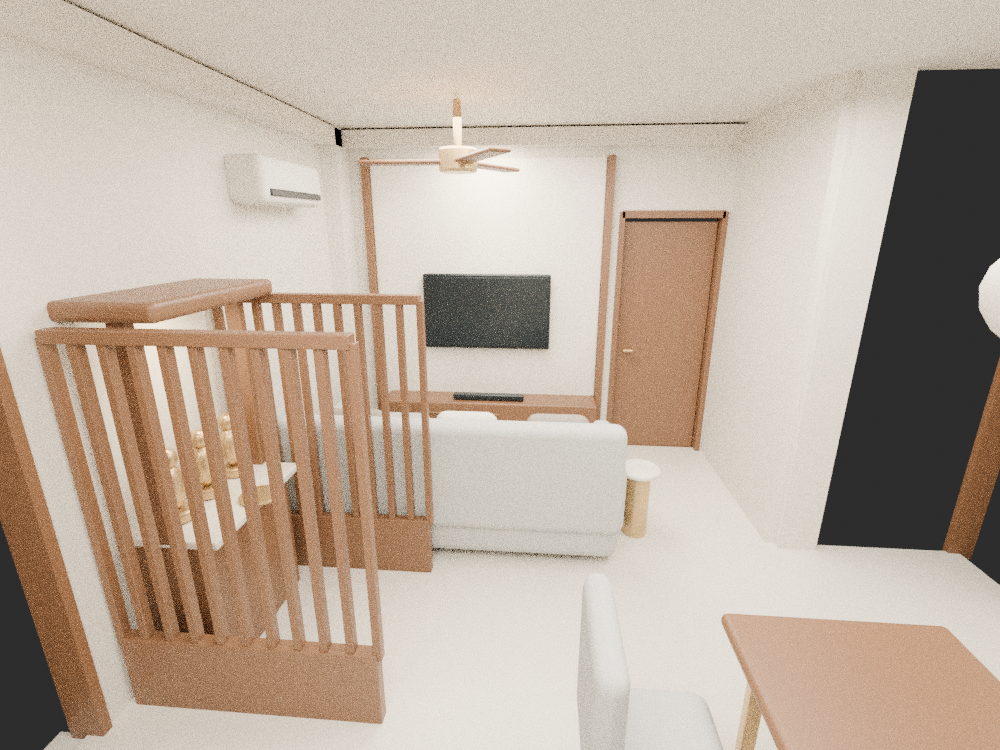
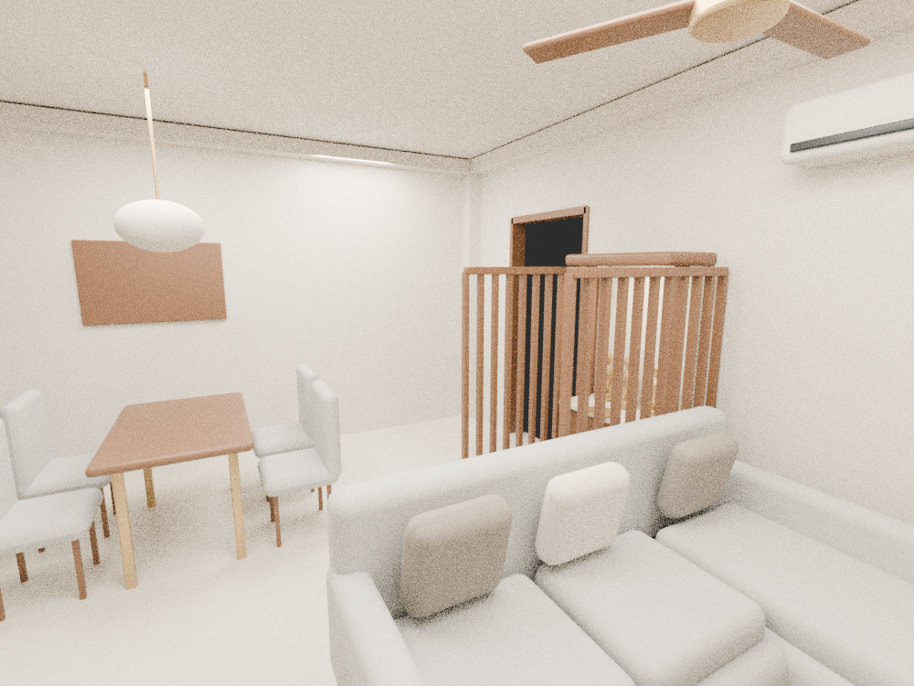
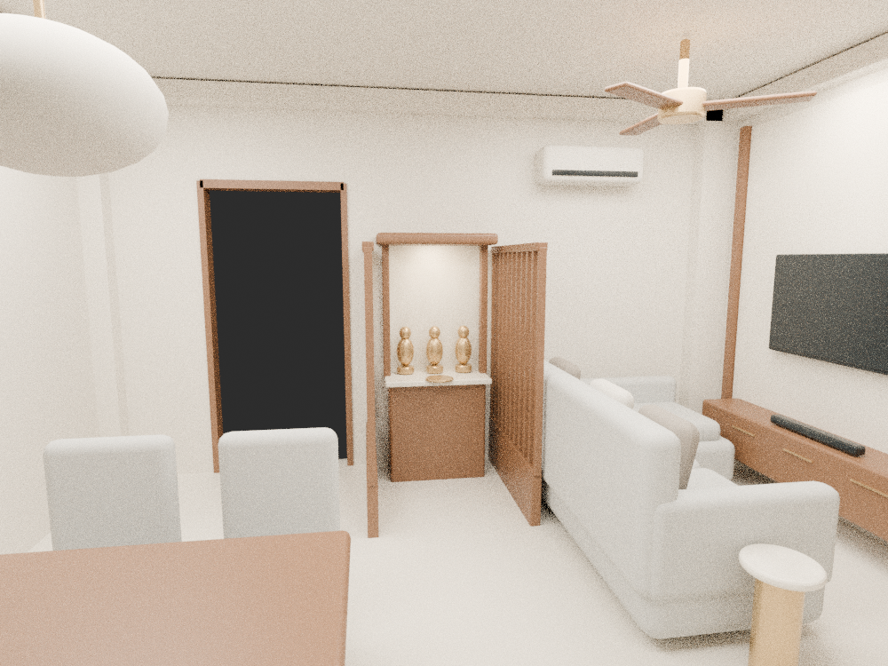
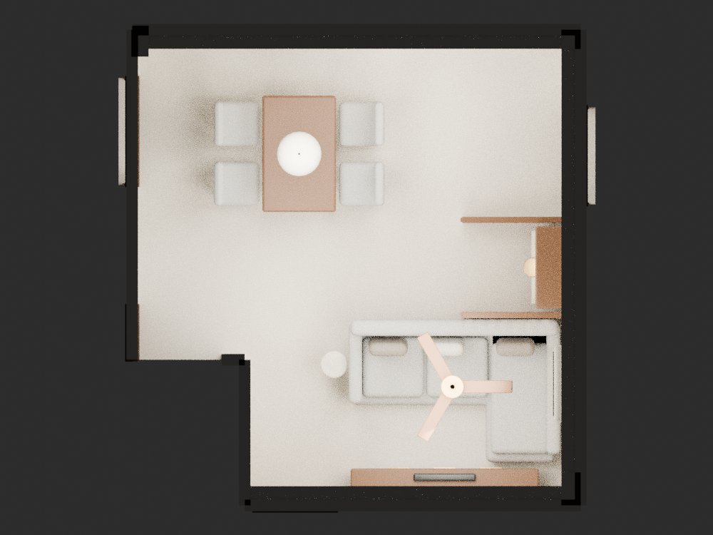

# L1 — one model, consistent views

The owner’s rough sketch controls this arrangement. These are geometric layout studies using one 3D scene, rather than separately generated room illustrations. Furniture and openings have fixed coordinates; only the camera changes. The ceiling is hidden for the top cutaway and visible in the interior views.

## Labelled top plan

[Vector plan](00-labelled-plan.svg) · [Owner’s sketch](owner-rough-layout.jpg)

## A — entrance side looking toward B2 and the TV

In this direction the plan’s right wall appears on the image’s left. Therefore the puja screens appear left and B2’s door appears right of the TV. This is the result of camera direction, not a moved room feature.

## B — B2 side looking back toward the entrance

This is the reverse direction in the same scene.

## C — dining side looking across to the puja nook

Both screens and the Singhasan share exactly the same positions as the other views.

## Roofless top render

## Fixed arrangement

- Kitchen access on the upper-left boundary of L1.
- Four-seat dining table lengthwise beside the kitchen.
- Main entry on the upper-right wall; no windows.
- Singhasan against the right wall between two short partitions, open to the room on its left.
- One partition behind the sofa; the other below the main entry in plan orientation.
- L sofa below the puja area, facing the TV on B2’s shared wall.
- B2’s doorway remains to the left of the TV in the top plan.

## Provisional dimensions and limits

The model uses the printed 15′2″ × 16′1″ (4.6228 × 4.9022 m) envelope. Door openings, pillar projections, notch dimensions and a 2.85 m ceiling are estimates; the photograph and rough sketch do not establish those measurements.

A central coffee table was omitted because it crowded the sofa-to-TV gap; a compact 0.28 m diameter side table is used instead.

The model uses a compact 2.14 m sofa with a 1.42 m chaise, a 1.20 × 0.76 m dining table and a compact Singhasan base approximately 0.70 m wide × 0.38 m deep. The puja bay is only about 1.13 × 0.98 m before furniture; it accommodates a small shrine and compact worship space. If the family needs more kneeling space or a larger existing Singhasan, this arrangement needs adjustment. Seating-to-screen distance is approximately 1.6 m for the provisional 50-inch screen; confirm the preferred TV size and viewing distance. Check actual door swings, screen placement and access before building.

Materials and deity forms are simplified placeholders for layout checking. Earlier polished AI images remain finish references only; they are superseded as spatial references.

## Reusable model

- [Blender scene](l1-fixed-layout.blend)
- [Coordinates and camera locations](layout.json)
- [Render consistency record](render-evidence.json)
- [Scene generator](../../../tools/render_l1_layout.py)
- [Plan generator](../../../tools/draw_l1_plan.py)

From repository root, run `blender -b --factory-startup --python tools/render_l1_layout.py`, then `python tools/draw_l1_plan.py`. PNG conversion of the SVG uses CairoSVG. All camera renders assert the same mesh transforms. The render record contains the shared geometry fingerprint and the ceiling cutaway state.
